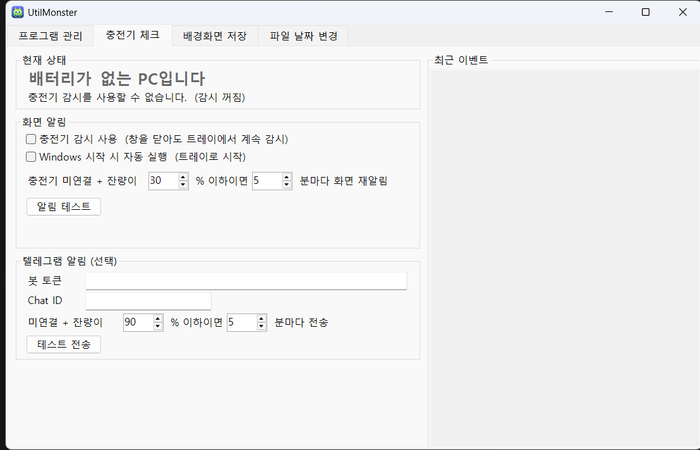
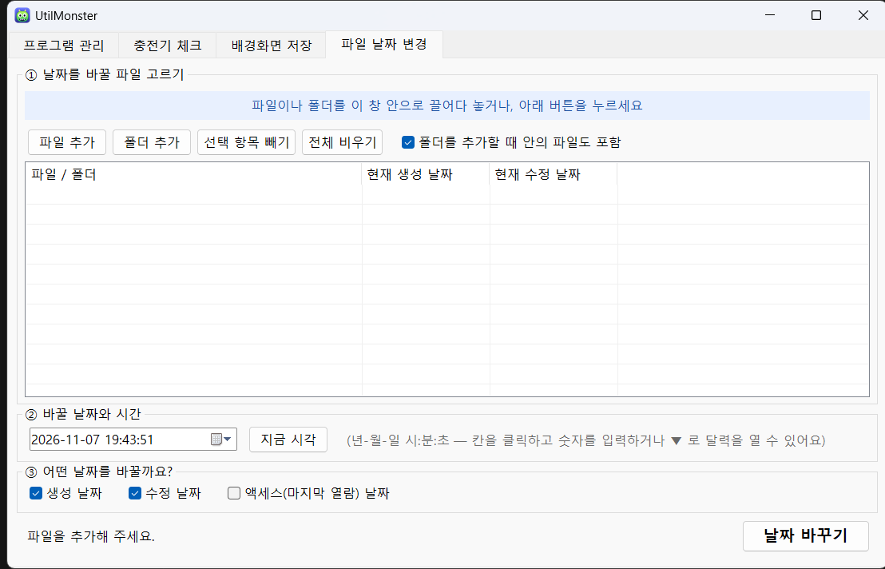

<p align="center">
  
</p>

<h1 align="center">UtilMonster</h1>

<p align="center">
  잔잔한 Windows 유틸리티들을 <b>탭 하나에 모아 둔</b> 작은 도구.<br>
  "그 프로그램 어디 뒀더라?" 할 필요 없이, 하나만 열고 탭으로 골라 씁니다.
</p>

<p align="center">
  
  
</p>

> 작은 도구는 계속 늘어나기 마련이라, **파일 하나만 추가하면 탭이 하나 생기는 구조**로 만들었습니다. ([새 탭 추가하기](#새-탭-추가하기))

## 들어 있는 기능

| 탭 | 하는 일 |
|---|---|
| **프로그램 관리** | 한 폴더 아래의 프로그램들을 목록으로 보여 주고, 실행 중인 프로세스·자동 실행 등록·크기·수정일을 확인합니다. 선택해서 실행 / 재시작 / 중지 / 자동 실행 해제 / 삭제(휴지통)할 수 있습니다. |
| **충전기 체크** | 노트북 충전기가 빠지는 순간 소리와 화면 맨 위 경고창으로 알려 줍니다. 배터리 잔량이 기준 이하이면 주기적으로 재알림하고, 텔레그램으로도 보낼 수 있습니다. 트레이에 상주하며 Windows 시작 시 자동 실행도 지원합니다. |
| **배경화면 저장** | 현재 바탕화면 이미지와 Windows 스포트라이트(잠금화면) 사진을 저장합니다. 가로형 사진만 썸네일로 보여 주고, 골라서 또는 전부 저장합니다. 같은 사진은 중복 저장하지 않습니다. |
| **파일 날짜 변경** | 파일·폴더의 **생성 / 수정 / 액세스 날짜**를 원하는 값으로 바꿉니다. 창으로 끌어다 놓으면 되고, 읽기 전용 파일도 가능합니다. |

## 요구 사항

- Windows 10 / 11
- Windows PowerShell 5.1 (Windows에 기본 포함 — **별도 설치 불필요**)

Python, .NET SDK 등 추가로 설치할 것은 없습니다.

## 설치 및 실행

1. 이 저장소를 내려받습니다. (`Code → Download ZIP` 또는 `git clone`)
2. 압축을 풀고 **`UtilMonster.exe`** 를 더블클릭합니다.

그게 전부입니다. 작업표시줄 고정이나 바탕화면 바로가기를 만들어 두면 편합니다.

```text
UtilMonster.exe -Tab 배경      # 특정 탭으로 바로 시작 (탭 이름의 일부)
UtilMonster.exe -Minimized     # 창 없이 트레이로 시작 (충전기 감시가 켜져 있을 때)
```

> **SmartScreen / 백신 경고가 뜰 수 있습니다.** `UtilMonster.exe` 는 서명되지 않은 작은 런처이고, 하는 일은 같은 폴더의
> `UtilMonster.ps1` 을 콘솔 창 없이 실행하는 것뿐입니다. 소스는 [`tools/Launcher.cs`](tools/Launcher.cs)(약 50줄)에 있고,
> 믿기 어렵다면 [직접 빌드](#exe-직접-빌드)하거나 `UtilMonster.ps1` 을 PowerShell에서 바로 실행해도 됩니다.
>
> ```powershell
> powershell -NoProfile -ExecutionPolicy Bypass -File .\UtilMonster.ps1
> ```
>
> `UtilMonster.exe`, `UtilMonster.ps1`, `modules\` 는 **항상 같은 폴더에** 있어야 하므로 옮길 때는 폴더째 옮기세요.

## 사용법

### 프로그램 관리
- **관리 폴더**는 기본적으로 UtilMonster가 들어 있는 폴더의 상위 폴더입니다. `폴더 변경`으로 바꿀 수 있습니다.
- 그 아래 하위 폴더 하나를 "프로그램 하나"로 봅니다. 폴더 안의 exe, 또는 python/PowerShell 등이 폴더의 스크립트를 실행 중이면 "실행 중"으로 표시합니다.
- `실행`은 폴더 안의 `main.py` / `start.bat` / `*.ps1` / `*.exe` 등을 자동 감지합니다. 맞지 않으면 `실행 설정`에서 명령을 직접 지정하세요.
- `삭제`는 먼저 프로세스를 끄고 자동 실행을 해제한 뒤 **폴더를 휴지통으로 보냅니다**(복구 가능). 실행 전에 확인 창이 뜹니다.
- UtilMonster 자신이 들어 있는 폴더는 중지·삭제 대상에서 제외됩니다.

### 충전기 체크
- `충전기 감시 사용`을 켜면 감시가 시작됩니다. 켜져 있는 동안에는 **창을 닫아도 트레이에서 계속 감시**하며, 트레이 아이콘 우클릭 → `종료`로 끝냅니다.
- `Windows 시작 시 자동 실행`은 시작 프로그램 폴더에 바로가기를 만들어, 로그인할 때 트레이로 조용히 시작합니다. (관리자 권한 불필요)
- 알림 규칙: 충전기가 빠지거나 감시를 켰을 때 이미 빠져 있으면 즉시 알림 → 이후 잔량이 기준 이하이면 설정한 간격마다 재알림.
- 텔레그램 알림(선택): [BotFather](https://t.me/BotFather)에서 받은 봇 토큰과 내 Chat ID를 입력하고 `테스트 전송`으로 확인합니다.
- 배터리가 없는 PC(데스크톱)에서는 "배터리가 없는 PC입니다"라고 표시되고 알림은 동작하지 않습니다.

### 배경화면 저장
- 스포트라이트 사진은 Windows가 내려받아 두는 캐시 폴더에서 읽습니다. 저장 위치 기본값은 `내 사진\WallpaperSaver`(`Desktop` / `Spotlight` 하위 폴더)이며 `저장 폴더...`로 바꿉니다.
- `현재 배경화면 저장`, `스포트라이트 전부 저장`, 또는 썸네일을 체크하고 `선택 저장`.
- 이미 저장된 사진은 파일 내용(SHA-256)으로 판별해 "이미 저장됨"으로 표시하고 체크할 수 없게 합니다.

### 파일 날짜 변경
1. 파일/폴더를 창으로 끌어다 놓거나 `파일 추가` / `폴더 추가`를 누릅니다. (폴더는 안의 파일도 함께 넣을지 선택)
2. 바꿀 날짜·시간을 고르고, 생성/수정/액세스 중 바꿀 항목을 체크합니다.
3. `날짜 바꾸기` → 확인.

## 새 탭 추가하기

`modules\` 폴더의 `.psm1` 파일 하나가 탭 하나입니다. 이름이 `_` 로 시작하는 파일은 무시됩니다.

1. [`modules/_Template.psm1`](modules/_Template.psm1)을 복사해 `modules\내도구.psm1` 로 저장합니다. (**UTF-8 BOM** 으로 저장해야 한글이 깨지지 않습니다 — Windows PowerShell 5.1 요구 사항)
2. `Get-UtilTabInfo` 의 `Title`(탭 이름)·`Order`(작을수록 왼쪽)를 고치고, `New-UtilTab` 안에 화면을 만듭니다.
3. UtilMonster를 다시 실행하면 탭이 생깁니다. **exe를 다시 만들 필요는 없습니다.**

```powershell
function Get-UtilTabInfo { @{ Title = '내 도구'; Order = 50; Eager = $false } }

function New-UtilTab {
    param([System.Windows.Forms.TabPage]$Page, $Ctx)
    # $Page 에 WinForms 컨트롤을 추가한다.
    # $Ctx.ConfigDir : 설정 파일을 둘 폴더   $Ctx.Form : 메인 창
    # $Ctx.KeepAlive['이름'] = $true : 창을 닫아도 트레이에서 계속 실행 (백그라운드 기능)
}
```

설계 메모:

- **탭은 처음 선택할 때 만들어집니다.** 탭이 늘어나도 시작 속도는 그대로입니다. (`Eager = $true` 면 시작할 때 바로 만듦 — 백그라운드 감시용)
- **모듈은 서로 격리**됩니다(PowerShell 모듈). 변수·함수 이름이 다른 탭과 겹쳐도 괜찮습니다.
- **한 탭이 오류 나도 그 탭에만 오류 메시지가 표시**되고 나머지는 정상 동작합니다. 자세한 내용은 `logs\UtilMonster.log` 에 남습니다.
- 이미 실행 중이면 다시 실행해도 새 창이 뜨지 않고 기존 창이 앞으로 옵니다.

## EXE 직접 빌드

Windows에 기본 포함된 .NET Framework 컴파일러를 사용하므로 별도 설치가 필요 없습니다.

```powershell
.\tools\MakeIcon.ps1     # 아이콘(UtilMonster.ico) 다시 그리기 — 코드로 그립니다
.\tools\Build-Exe.ps1    # UtilMonster.exe 다시 만들기
```

## 폴더 구조

```text
UtilMonster.exe          실행 파일 (런처)
UtilMonster.ico          아이콘
UtilMonster.ps1          본체: 창 + 탭 + 트레이, 모듈 로더
modules\                 탭 하나 = 파일 하나
  AppManager.psm1        프로그램 관리
  ChargerCheck.psm1      충전기 체크
  WallpaperSaver.psm1    배경화면 저장
  FileDateChanger.psm1   파일 날짜 변경
  _Template.psm1         새 탭 템플릿
tools\                   exe / 아이콘 빌드 도구
config\  logs\           실행하면 자동으로 생기는 설정·로그 (git 제외)
```

## 알아둘 점

- **개인 설정은 저장소에 올라가지 않습니다.** `config\`(텔레그램 토큰 포함)와 `logs\` 는 `.gitignore` 로 제외되어 있습니다. 텔레그램 봇 토큰은 `config\ChargerCheck.json` 에 **평문**으로 저장되므로 그 파일을 공유하지 마세요.
- **프로그램 관리 탭은 프로세스를 종료하고 폴더를 삭제할 수 있는 도구**입니다. 삭제는 휴지통으로 가지만, 대상을 확인한 뒤 사용하세요.
- 충전기 체크가 시작 프로그램에 만드는 바로가기 이름은 `UtilMonster.lnk` 입니다. 자동 실행을 끄면 지워집니다.
- 이 탭의 전신인 단독 실행형 `ChargerCheck` 가 남아 있으면 알림이 겹치지 않도록 한쪽만 감시합니다. 충전기 탭에 `기존 항목 정리` 버튼이 나타납니다.

## 문제 해결

- **탭이 오류 메시지만 보여 줍니다** → `logs\UtilMonster.log` 를 확인하세요.
- **한글이 깨져 보입니다** → `.ps1` / `.psm1` 파일이 UTF-8 **BOM** 으로 저장돼 있어야 합니다.
- **창이 안 뜨는데 실행은 된 것 같습니다** → 충전기 감시가 켜져 있으면 트레이에서 계속 실행 중일 수 있습니다. UtilMonster를 한 번 더 실행하면 그 창이 앞으로 옵니다.

## 라이선스

아직 지정하지 않았습니다. (라이선스 파일이 없으면 기본적으로 모든 권리가 저작권자에게 있습니다. 공개 사용을 허용하려면 `LICENSE` 를 추가하세요.)
